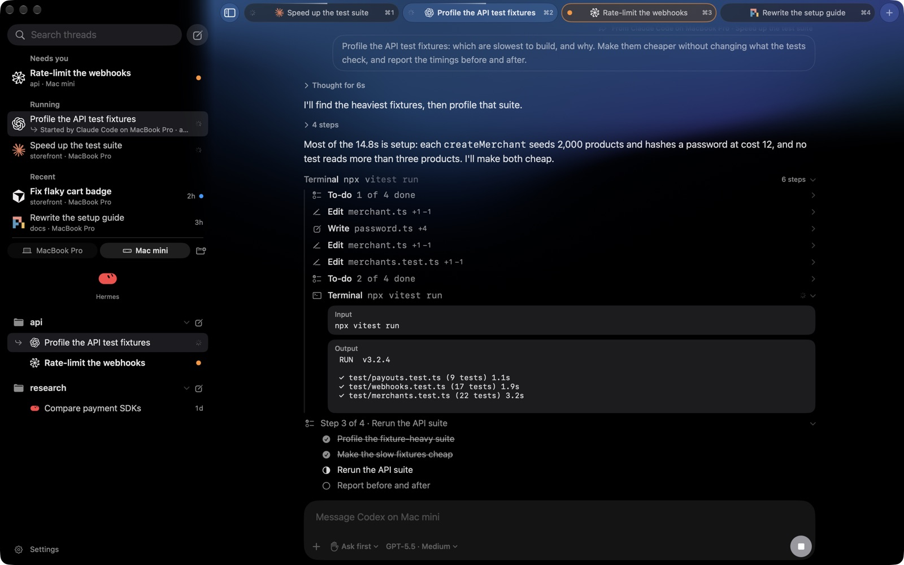
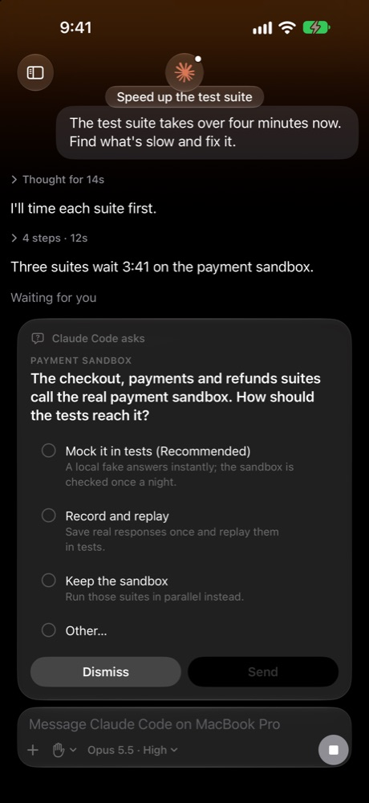
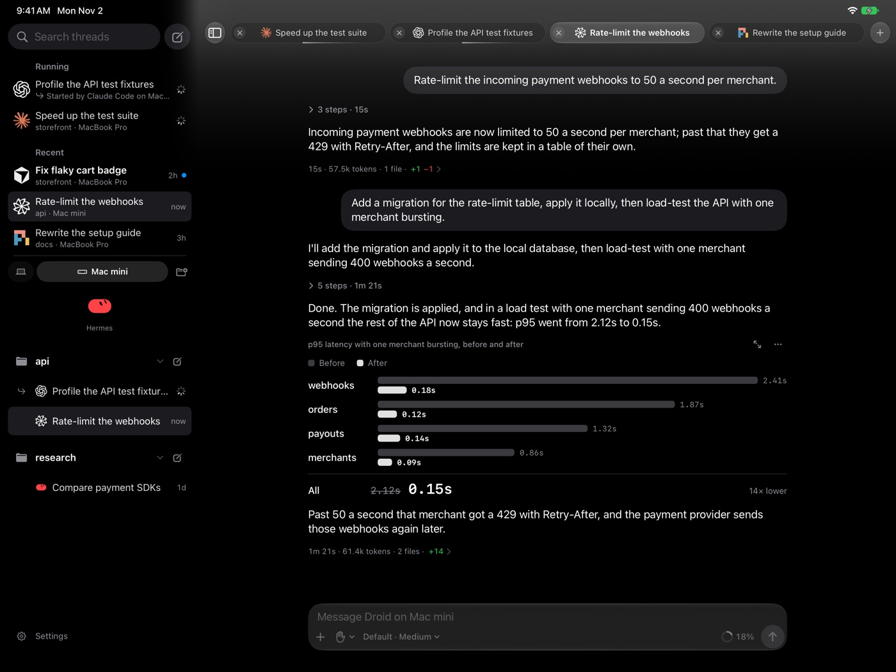

# Portals

<p align="center">
  
</p>

<p align="center">
  <strong>Orchestrate your agent fleet across every computer you own, from any device, instantly in sync.</strong>
</p>

<p align="center">
  <a href="https://github.com/DanielOu1208/portals/releases/latest">Download for Mac</a> ·
  <a href="https://testflight.apple.com/join/TMV8FWA5">iPhone and iPad on TestFlight</a> ·
  <a href="#getting-started">Getting started</a> ·
  <a href="#build-from-source">Build from source</a> ·
  <a href="#privacy">Privacy</a>
</p>

<p align="center">
  <a href="https://github.com/DanielOu1208/portals/releases/latest"></a>
  <a href="https://www.npmjs.com/package/portals-host"></a>
  <a href="LICENSE"></a>
  <a href="#getting-started"></a>
  <a href="#getting-started"></a>
</p>

---

A native iPhone, iPad and Mac app for Claude Code, Codex, Cursor, Droid, Pi, Hermes and OpenCode 2. Agents run on your own Mac or Linux computers, and you can pick up any thread from any device. Currently in alpha.

<p align="center">
  
</p>

## Features

- **Every agent in one place,** each with your own account and settings.
- **All your computers.** Every device reaches every Mac or Linux computer you set up.
- **In sync everywhere.** Threads, what you've read, sidebar order and queued messages.
- **Approve from anywhere.** Allow commands and edits from a card, with a permission mode per thread.
- **Steer while it works.** Change course or queue the next message, with `/` commands, `@` files and pictures.
- **See what it's doing.** Steps, live command output, plans, subagents, workflows and each turn's changes.
- **Agents together.** Ask Claude Code to "start a Codex thread to review this", then follow it from there.
- **Private notifications.** Encrypted on your computer, readable only on your device.
- **Visuals in the chat.** Interactive charts and diagrams, and typeset formulas.

<p align="center">
  
  &nbsp;
  
</p>

## Getting started

You need:

- **A Mac or Linux computer** with [Node 22.18 or newer](https://nodejs.org) and at least one agent signed in.
- **[Tailscale](https://tailscale.com)** on that computer and your devices, on the same account. Only using Portals on the Mac your agents run on? You can skip it, and add it later for your iPhone or iPad.
- **An iPhone, iPad or Mac** on iOS or macOS 26.1 or newer.

Then:

1. **Get the app.** [Download the DMG](https://github.com/DanielOu1208/portals/releases/latest) for Mac, or [join on TestFlight](https://testflight.apple.com/join/TMV8FWA5) for iPhone and iPad.
2. **Set up the host** on the computer your agents run on:

   ```sh
   npx portals-host setup
   ```

   It asks before changing Tailscale or installing anything.
3. **Add it to the app.** Scan the QR code, or paste the link on an iPad or Mac.

Run setup again to add another computer. See the [host's guide](bridge/README.md) for options, Linux and updates, and the [tester's guide](https://portals.build/start) for the app.

## How it works

The app doesn't run agents. A small host, `portals-host`, runs beside them on each computer, listening only on `127.0.0.1`. Your devices reach it over your Tailscale network or, when they can't, through the Portals relay, encrypted so only your device and computer can read it. Portals on the same Mac can go without Tailscale and reach it directly.

| Folder | What's in it |
|---|---|
| [`Portals/`](Portals) | The SwiftUI app for iPhone, iPad and Mac |
| [`PortalsNotifications/`](PortalsNotifications) | The extension that opens encrypted notifications |
| [`Packages/PortalsKit/`](Packages/PortalsKit) | The app's core: threads, sync and the wire protocol |
| [`bridge/`](bridge) | The host, published as [`portals-host`](https://www.npmjs.com/package/portals-host) (the folder keeps its old name) |
| [`relay/`](relay) | The Cloudflare Worker behind notifications and the backup connection |
| [`hermes-plugin/`](hermes-plugin) | A Hermes plugin for notifications |
| [`docs/`](docs) | The [protocol](docs/gateway-protocol.md), [pairing and relay](docs/pairing-and-relay.md), and design and performance notes |

## Privacy

- **No account, no tracking.** Each host sends anonymous daily totals, which you can turn off ([below](#anonymous-usage-totals)).
- **Your work stays on your computers,** and goes only to the AI providers you use.
- **Your device keeps** the computers you've added and your settings, with passwords in the Keychain.
- **The relay can't read what it passes.** It's encrypted end to end, and no notifications are kept.

[Privacy policy](https://portals.build/privacy) · [Report a security issue](SECURITY.md)

## Anonymous usage totals

So we can see how much Portals is used, each host sends a few numbers a day: how many
turns ran through Portals, how many devices connected, and how many tokens went through
it. They're on by default and easy to turn off. Nothing is sent about what you work on.

**What's sent.** Once a day, the host sends each finished day it was used on (a Portals
turn started, or a device connected) that it hasn't sent yet, at most the last 7. A day
it can't send is tried again later. Each day is one `POST` to
`https://portals-stats.danielou1208.workers.dev/v1/day` with these fields, and no others:

| Field | What it holds |
|---|---|
| `v` | The format's version, `1` |
| `install` | A random id the host made for itself once (`state/usage/install.json`), not taken from the hardware |
| `owner` | The first 32 hex digits of a SHA-256 of your net's id, the same on every computer in your net, so we count people and not computers. The net's id itself isn't sent. A host in no net sends its `install` id here |
| `day` | The date the numbers are for, on the host's clock |
| `version` | The version of `portals-host` |
| `os` | `darwin` or `linux` |
| `turns` | How many Portals turns started that day |
| `portals` | How many devices connected that day, by kind: `iphone`, `ipad`, `mac` and `other` (a device that doesn't say) |
| `usage` | For each agent and model, only what went through Portals: `agent`, `model`, `requests`, `input`, `output`, `cache_read`, `cache_write` and `reasoning` tokens, and `usd`, what they'd cost at API prices. A model the host's price table doesn't know is sent as `other` |

**What's never sent:** prompts, replies, thread titles, file paths, folder names, device
or computer names, account details, or any model name outside the price table. The
server uses your IP address only to limit how often one address can send, never keeps
it, and keeps no logs. Only the maintainer can read the days.

**Turning it off.** Any one of these stops it, and the host lets go of anything it
counted and hadn't sent:

- In the app: Settings → Usage → Share anonymous totals, for that host
- On the host's computer: `npx portals-host telemetry off` (`npx portals-host telemetry status` shows whether it's on, and the last day it sent)
- In the host's `config.json`: `"telemetry": false`
- In the host's environment: `DO_NOT_TRACK=1` or `PORTALS_TELEMETRY=0`, which keep it off whatever `config.json` says. The host's service doesn't see your shell's variables, so running setup with `DO_NOT_TRACK` set also writes `"telemetry": false`

`PORTALS_STATS_URL` sends the days to another address instead, for your own server.

## Build from source

<details>
<summary>Build the app with Xcode</summary>

Built with Xcode 27.

```sh
git clone https://github.com/DanielOu1208/portals.git
cd portals
open Portals.xcodeproj
```

Run the `Portals` scheme on a simulator; that needs no signing. To look around with no host, set `PORTALS_DEBUG_HOSTS=[]` and `PORTALS_DEBUG_DEMO=1` in the scheme's environment.

To run on a device, copy `Config/Local.example.xcconfig` to `Config/Local.xcconfig` and set your team. Then replace `com.danielou.portals` on both targets and `PORTALS_APP_GROUP` in `Config/Shared.xcconfig` with IDs of your own.

The hosted relay only sends notifications for the official app. For notifications in your own build, [deploy your own relay](relay/README.md#deploying) with your own APNs key, then point `PORTALS_RELAY_URL` in `Config/Portals.xcconfig` and `push.relay` and `relay.url` in the host's `config.json` at it.

</details>

<details>
<summary>Run the host from source</summary>

```sh
cd bridge
npm ci
npm start
```

[`bridge/DEVELOPING.md`](bridge/DEVELOPING.md) explains how the host works.

</details>

<details>
<summary>Run the tests</summary>

```sh
(cd Packages/PortalsKit && swift test)
(cd bridge && npm ci && npm test)
(cd relay && npm ci && npm test)
```

</details>

## Support

[Open an issue](https://github.com/DanielOu1208/portals/issues) for bugs or focused feature requests. Pull requests are welcome; see [CONTRIBUTING.md](CONTRIBUTING.md).

## License

Source code and original artwork use the [MIT License](LICENSE). The agents' logos belong to their owners, and Portals isn't affiliated with or endorsed by them; see [third-party notices](THIRD_PARTY_NOTICES.md).
